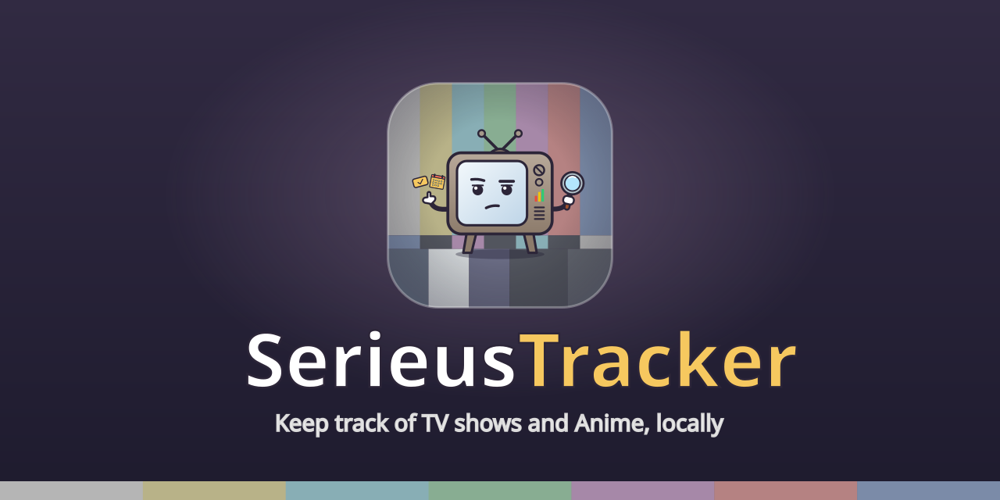
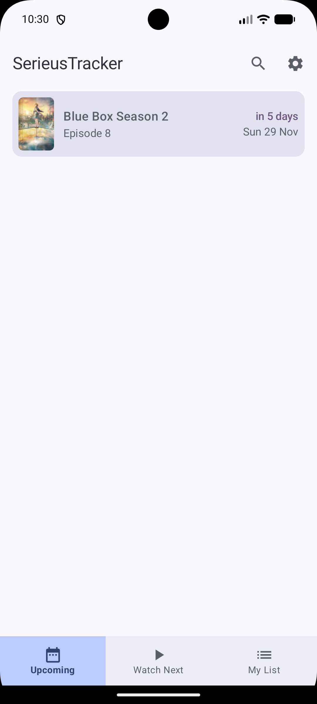
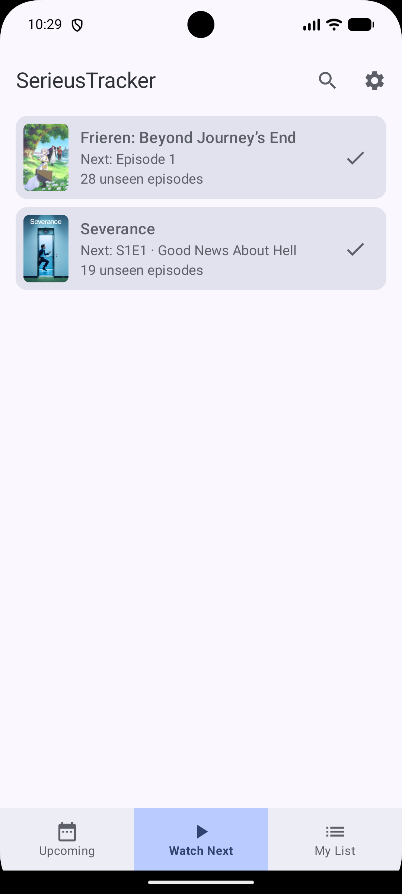
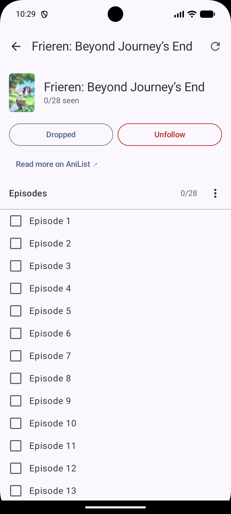
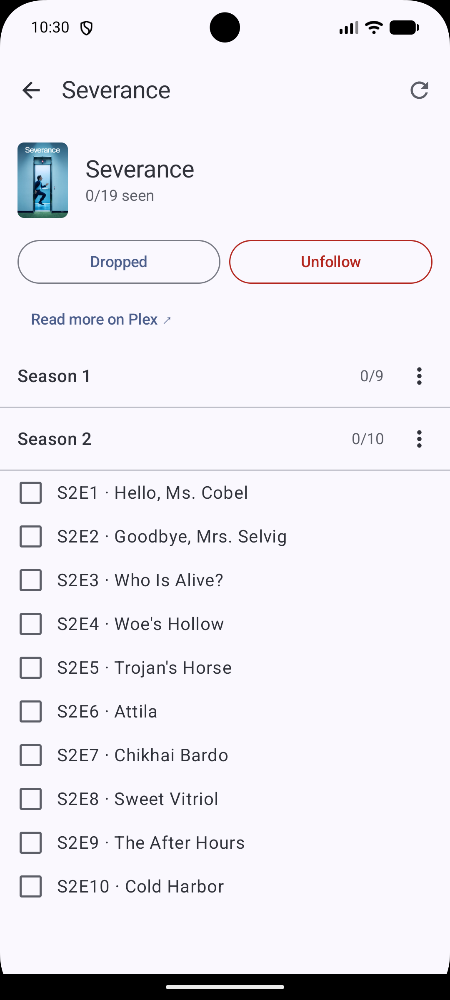
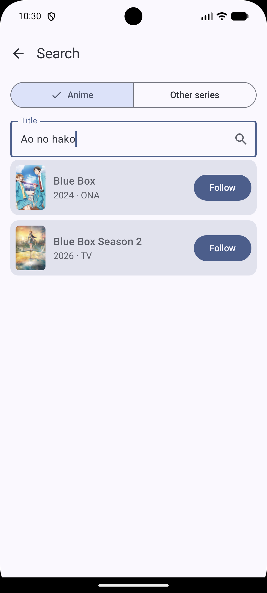

An Android app for keeping track of the TV series and anime you follow: what has aired, what you have seen, and what comes next.

- **Anime** is looked up on [AniList](https://anilist.co) (no account needed).
- **Other series** are looked up through [Plex](https://www.plex.tv) (a free Plex account is needed).
- Your list lives **on your device**. There is no SerieusTracker account and no server of its own.
- The backup file is plain, human-readable JSON that you can also write by hand, so you can bring a list over from another app. See [docs/FILE_FORMAT.md](docs/FILE_FORMAT.md).

<table>
  <tr>
    <td align="center"><br><sub>Upcoming</sub></td>
    <td align="center"><br><sub>Watch Next</sub></td>
    <td align="center"><br><sub>Anime</sub></td>
    <td align="center"><br><sub>TV show</sub></td>
    <td align="center"><br><sub>Search</sub></td>
  </tr>
</table>
---

## Contents

- [Features](#features)
- [How the app works](#how-the-app-works)
- [Using the app](#using-the-app)
- [Export and import](#export-and-import)
- [Plex integration](#plex-integration)
- [Languages](#languages)
- [Building from source](#building-from-source)
- [Project structure](#project-structure)
- [Data storage and privacy](#data-storage-and-privacy)
- [Known limitations](#known-limitations)
- [Troubleshooting](#troubleshooting)
- [Disclaimer](#disclaimer)
- [License](#license)

---

## Features

**Tracking**

- Follow series and anime found through search.
- Mark single episodes, a whole season, or the next episode as seen.
- Three views of your list: **Upcoming**, **Watch Next** and **My List** (see [below](#using-the-app)).
- Drop a show you have given up on. It stays in My List, but disappears from Upcoming and Watch Next and is no longer refreshed.
- Progress is never overwritten by a refresh. Episode data is updated, your "seen" markers are not touched.

**Data sources**

- AniList GraphQL API for anime.
- Plex cloud metadata for other series, including season and episode titles and air dates.
- Import of your watch history from your own Plex Media Server.

**Backup and import**

- Export to a small, readable JSON file and import it again, on the same or another device.
- Import is additive: it never removes shows or unmarks episodes.
- Entries in an import file can be given by **name only**; the app looks up the id for you.

**Other**

- Material 3 design, light and dark theme, edge-to-edge layout.
- Language picker (drop-down) that follows the Android per-app language setting. English and Swedish are included.
- The Plex sign-in token is stored encrypted with a key in the Android Keystore.

---

## How the app works

### Episodes and "aired"

Every show has a list of episodes with an air date. An episode counts as **aired** when its date is today or earlier.

| | AniList (anime) | Plex (other series) |
|---|---|---|
| Seasons | Always season 1 (AniList describes a season as its own entry) | Real seasons, numbered as in Plex |
| Episode titles | Not available (shown as "Episode N") | Yes |
| Air dates | Only the date of the **next** episode is known | Date for every episode when Plex has it |
| Older episodes | Get a placeholder date, so they count as aired but show "Date unknown" | Real dates |
| Specials (season 0) | Not applicable | Ignored |

Show data is cached on the device, so the list works offline. Data is refreshed when it is older than six hours, when you pull down to refresh, or when you press **Refresh all shows** in Settings. Up to three shows are refreshed in parallel.

### Seen markers

"Seen" is stored per show as a set of season/episode pairs (internally `"1x5"` for season 1, episode 5). Because they are stored separately from the downloaded episode list, a refresh can never lose your progress.

### The three views

- **Upcoming**: shows whose next episode has a future air date, sorted by date, with "Today", "Tomorrow" or "in N days".
- **Watch Next**: shows that have at least one aired episode you have not seen. Sorted by most recently watched, so the show you are in the middle of is on top. The check button marks the next unseen episode.
- **My List**: everything you follow, with a progress bar (`seen/aired`). Dropped shows are collected in a collapsible, dimmed section.

---

## Using the app

### Following a show

1. Tap the search icon.
2. Choose **Anime** (AniList) or **Other series** (Plex).
3. Type a title and tap **Follow** on the result.

Searching **Other series** requires that you are signed in to Plex (see [Plex integration](#plex-integration)).

### Show details

Tap a show to open its page. From there you can:

- tick or untick individual episodes,
- use the menu on a season to **mark all aired episodes as seen** or **clear** the season,
- refresh the show,
- **drop** or **resume** it,
- **unfollow** it (this deletes your progress for the show, after a confirmation),
- open the show's page on AniList or Plex.

### Refreshing

Pull down on any list to refresh all shows. Dropped shows are skipped, except that a dropped show that has no data at all (for example after an import) is fetched once so that it gets a title and a poster.

---

## Export and import

Settings → **Data** has **Export** and **Import** buttons, with a short explanation in the app.

- **Export** writes your list to a file you choose: the shows you follow, the episodes you have seen, which shows are dropped and when you last watched each one. Posters and episode lists are not saved; they are downloaded again after an import.
- **Import** reads such a file and **adds** it to your list. Shows and seen episodes in the file are added. Nothing you already have is removed or unmarked, and a show you already follow keeps its status (dropped or not) and its downloaded data.

An exported file looks like this:

```json
{
  "app": "SerieusTracker",
  "version": 1,
  "shows": [
    {"name": "Frieren: Beyond Journey's End", "source": "anilist", "id": 154587, "seen": {"1": "1-12, 14"}},
    {"name": "Severance", "source": "plex", "id": "5d9c0866a1b2c3d4", "seen": {"1": "1-9", "2": "1-4, 6"}, "dropped": true, "lastWatched": "2026-11-20T21:14:00Z"}
  ]
}
```

The same format works for lists you write yourself, and entries may identify a show by `name` instead of `id`:

```json
{"name": "Cowboy Bebop", "source": "anilist", "seen": "1-26"}
```

After an import the app shows how many shows were added and how many episodes were marked, how many entries could not be read, and which names could not be found.

The complete specification, with all fields, accepted shapes and edge cases, is in **[docs/FILE_FORMAT.md](docs/FILE_FORMAT.md)**.

---

## Plex integration

Plex is used for three things. All of them are optional and none of them is needed for anime.

### 1. Sign-in (metadata for other series)

Settings → **Plex account** → **Sign in** starts Plex's PIN flow: the app asks plex.tv for a PIN, opens the Plex approval page in your browser, and polls until you approve. You can also paste an existing Plex token instead. The token is needed to search and to read episode data for non-anime series.

If Plex stops accepting the token, a banner appears on the main screen and Plex shows are not updated until you sign in again. Anime keeps working.

### 2. Your Plex Media Server (watch history)

Settings → **Plex server**: enter the address of your server, for example `http://192.168.1.10:32400`. Then **Get watch history from Plex**:

1. The app connects to the server and reads all episodes marked as watched in its TV libraries (in pages of 500).
2. Each watched show is matched to a show in the app: first by the Plex id in the show's GUID (`plex://show/<id>`), then by an exact title search on Plex (ignoring case). If Plex does not know the show, an exact title search on AniList is tried as a fallback, for anime. AniList matches only count season 1.
3. Missing shows are added and episode data is downloaded.
4. Watched episodes are marked as seen.

This only **adds**. Existing progress is kept, nothing is unmarked or deleted. Shows that could not be matched are listed at the end.

The server is contacted directly from the phone, so the phone must be able to reach it (usually the same network or a VPN). Plain `http://` addresses are allowed for this reason (see [privacy](#data-storage-and-privacy)).

### 3. Diagnostics

Settings → **Test Plex** → **Run test** performs a small search and shows the start of the raw response, which helps when something does not work.

---

## Languages

The language picker in Settings is a drop-down list. It uses Android's per-app language support, so the choice is also visible in the system's per-app language settings. **System default** follows the device language.

**Adding a language**

1. Copy `app/src/main/res/values/strings.xml` to `app/src/main/res/values-xx/strings.xml` (`xx` is the language code, for example `values-de`).
2. Translate the strings. Keep the placeholders (`%1$d`, `%2$s` and so on) and use `\'` for apostrophes.
3. Build. The new language shows up in the picker automatically, under its own name.

The list of languages is read from the locale config that the Android Gradle Plugin generates from the `values-xx` folders (`androidResources { generateLocaleConfig = true }`, AGP 8.1 or newer). `res/resources.properties` declares English as the default language. Reading the list and changing the app language use APIs from Android 13 and 14, see [known limitations](#known-limitations).

The example file in the settings screen and the field names of the file format are intentionally not translated.

---

## Building from source

**Requirements**

- A recent Android Studio (one that supports Jetpack Compose and Android Gradle Plugin 8.1 or newer).
- An Android device or emulator. The minimum Android version is set in `app/build.gradle(.kts)`.
- No API keys. AniList and Plex sign-in need none.

**Steps**

1. Clone the repository and open it in Android Studio.
2. Let Gradle sync.
3. Run the `app` configuration on a device or emulator.

**Main dependencies** (versions are in the Gradle files)

| Library | Used for |
|---|---|
| Jetpack Compose, Material 3 | UI |
| Navigation Compose | Navigation between screens |
| Lifecycle ViewModel and runtime for Compose | State handling |
| OkHttp | HTTP requests (AniList, plex.tv, Plex server) |
| kotlinx.coroutines | Asynchronous work |
| `org.json` (part of Android) | JSON, so no extra JSON library is needed |

---

## Project structure

Package `com.mlw.serieustracker`, about 2,700 lines of Kotlin in a single `app` module.

```
app/src/main/
├── java/com/mlw/serieustracker/
│   ├── MainActivity.kt            Entry point, sets up theme and navigation
│   ├── data/
│   │   ├── Models.kt              Show, Episode, SearchResult, Source, and the internal JSON mapping
│   │   ├── Library.kt             The user's list: in-memory StateFlow + persistence + import merge
│   │   ├── ShowListFile.kt        Export/import file format (writer, tolerant parser, episode ranges)
│   │   ├── ShowRepository.kt      Combines Library with AniList/Plex: search, refresh, name lookup, history import
│   │   ├── Prefs.kt               Settings (server address, client id, token access)
│   │   └── SecureStore.kt         AES-256-GCM encryption with an Android Keystore key
│   ├── network/
│   │   ├── Http.kt                Shared OkHttp client
│   │   ├── AniListApi.kt          AniList GraphQL: search and show details
│   │   └── PlexApi.kt             plex.tv sign-in, Plex metadata, and the user's own server
│   └── ui/
│       ├── AppNavigation.kt       NavHost: main, search, settings, show
│       ├── AppViewModel.kt        The single ViewModel, all user actions
│       ├── UiText.kt              Text that can be resolved from string resources later
│       ├── components/Common.kt   Shared composables and date helpers
│       ├── screens/               MainScreen, SearchScreen, DetailScreen, SettingsScreen
│       └── theme/                 Material 3 colours, typography, theme
└── res/
    ├── values/strings.xml         English strings (default)
    ├── values-sv/strings.xml      Swedish strings
    ├── resources.properties       Default locale for the generated locale config
    └── xml/                       Backup and data-extraction rules
```

### Architecture in short

- **One ViewModel** (`AppViewModel`) owns UI state and all actions. Screens are stateless composables that read from it.
- **`Library`** is the single source of truth for the list. It exposes a `StateFlow<Map<String, Show>>`, applies every change in memory first and then writes the file in the background.
- **`ShowRepository`** is the only place that combines the local list with remote data, so the UI never talks to the network directly.
- **Shows are keyed** by a source prefix plus id (`al154587`, `px5d9c…`), so AniList and Plex ids can never collide.
- **`UiText`** lets the ViewModel produce messages (with string resources, plurals and arguments) without holding a `Context`; they are turned into text in the UI and therefore follow the selected language.
- Errors from the network are mapped to readable messages (expired Plex login, unreachable server, HTTP error, no connection).

### The two JSON formats

The app deliberately uses two different formats:

| | Internal (`library.json`) | Export/import file |
|---|---|---|
| Purpose | Working storage and cache | Backup and exchange |
| Contains | Everything, including posters, episode lists, dates and `updatedAt` | Only what you created |
| Audience | The app | Humans and other tools |
| Specification | Not stable, may change between versions | [docs/FILE_FORMAT.md](docs/FILE_FORMAT.md) |

---

## Data storage and privacy

- **Local only.** The list is stored in the app's private storage (`library.json`). Writes go to a temporary file that is then renamed, so a crash cannot leave a half-written file.
- **No analytics, no tracking, no ads, no own backend.**
- **Network traffic** goes only to:
  - `graphql.anilist.co` for anime search and details,
  - `plex.tv`, `discover.provider.plex.tv` and `metadata.provider.plex.tv` for sign-in, search and episode data of other series,
  - your own Plex server, only when you use the watch history import.
- **The Plex token** is encrypted with AES-256-GCM using a key held in the Android Keystore. The encrypted value is excluded from Android backups and device transfer (`backup_rules.xml`, `data_extraction_rules.xml`), because the key cannot be moved to another device. After a restore you sign in to Plex again.
- **Android backup** is enabled for the rest of the app data, so your list can be restored by Android's own backup. The export file is a separate and more portable option.
- **Cleartext HTTP** is allowed (`usesCleartextTraffic="true"`) so that the app can talk to a Plex server on your local network by IP address, where HTTPS usually is not available. Requests to AniList and plex.tv use HTTPS. If you do not use the watch history import, you can turn this off in `AndroidManifest.xml`.
- The Plex token is sent as a query parameter, which is how the Plex API works. For your own server this means it travels in plain text on your network when you use an `http://` address.

---

## Known limitations

- **Romaji titles and name-only import.** When an import entry has only a `name`, the app searches AniList or Plex and accepts a result whose title matches **exactly** (ignoring case and punctuation). For AniList the title that is compared is the English title if there is one, otherwise the romaji title. A romaji name such as "Sousou no Frieren" is therefore not matched, because the result is called "Frieren: Beyond Journey's End". Use the title shown in the app, or give an `id`. Matching on all title variants is a planned improvement.
- **Anime has one season.** AniList treats each season as its own entry. Follow each season separately. History from Plex is applied only to season 1 of an AniList match.
- **AniList air dates.** Only the next episode has a date, older episodes show "Date unknown".
- **Plex is needed for non-anime.** Searching and refreshing Plex shows requires a Plex login.
- **Android version.** The per-app language feature uses `LocaleManager` (Android 13) and `LocaleConfig` (Android 14). On older versions the language picker may be unavailable or only offer the built-in languages.
- **Seen episodes outside the episode list.** An import can mark episodes that a show does not (yet) have. They are stored and take effect if the episode appears later.
- **No tests yet.** The project has no automated tests at the moment.

---

## Troubleshooting

**"Sign in to Plex in Settings first" / the expired banner**
Sign in again under Settings → Plex account. Anime does not need Plex.

**"Could not reach http://…" when importing history**
Check the address (including the port, normally `:32400`), that the phone is on the same network as the server or connected through a VPN, and that the server is running. Use **Test Plex** only for the Plex cloud; the server address is tested when you start the history import.

**A show has no episodes**
Pull down to refresh, or open the show and press refresh. Plex shows need a valid sign-in.

**Import says "could not be read as a list of shows"**
The file is not valid JSON, or it has no `shows` list. Check commas and quotation marks, or start from the example in the app.

**Import says "N entries could not be read"**
Those entries have an unknown `source` (use `anilist` or `plex`), neither an `id` nor a `name`, or an AniList `id` that is not a plain number.

**Import says "Could not find: …"**
The name did not match a search result exactly. See [known limitations](#known-limitations); use the title shown in the app or give an `id`.

---

## Disclaimer

SerieusTracker is an independent project. It is not affiliated with, endorsed by, or sponsored by AniList or Plex. Names and logos belong to their owners. Please follow the terms of use of the services you connect to, and note that AniList rate limits its public API.

## License

No license has been chosen yet. Until a `LICENSE` file is added to the repository, all rights are reserved by the author.
